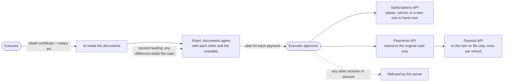

# Lastly

*6 minute read, about 2 for the top through the judges' table. The longer pages are linked where they come up.*


The whole case in one minute, from the documents to the closing screen.

When someone dies, their PayPal subscriptions keep charging. Lastly is for the person they chose to settle their affairs. It stops those charges and refunds the ones taken after the death to the card they came from. It creates a handover link so whoever keeps a shared subscription can take it over, and it writes the letter for a merchant with a contract. Then it pays the recovered money to the heir.


We built it for the PayPal AI Hackathon. It runs on the PayPal Sandbox only, and every person in it is fictional.

We live in Belgium, so the demo estate is Belgian: amounts are in euros and dates are written day first. The same flow works anywhere PayPal does. Three terms, in US terms:
- **Notary act:** the document a Belgian notary draws up after a death, naming the heirs and the executor. It does the job that letters testamentary from a probate court do in the US.
- **Mandate:** the note Jean signed while alive naming who settles his affairs, much like a legacy contact on a phone.
- **Executor and heir:** the executor settles the affairs, and the heir inherits the money. In the demo, Marie is both.

**Live demo: https://lastly-rdeo.onrender.com/estate**

It runs on Render's free plan, so the first load after a quiet spell can take about a minute.

## For judges: where to find each thing you score

| Criterion | What we did | Check it in under a minute |
|---|---|---|
| Technological Implementation | The running app calls 10 PayPal Sandbox endpoints ([listed with code links](docs/paypal-apis.md)), and each write has its own idempotency key. The AI reads the documents, reads them again on its own, explains each decision and writes the merchant letter. | Open the demo case and approve. Each ledger row shows the ID PayPal returns. Code: [`lib/paypal.ts`](lib/paypal.ts) and [`app/api/estate/execute/route.ts`](app/api/estate/execute/route.ts). Run any attack against the live checks on [Try to cheat it](https://lastly-rdeo.onrender.com/try-to-cheat-it). |
| Design | One flow from sign-in to the report for the notary, written for someone a few weeks after a death. | [Try it](#try-it) (five steps) and [Writing for someone grieving](docs/writing-for-someone-grieving.md). |
| Potential Impact | Charges that keep running after a death, refunded to source, and a shared subscription handed over instead of lost. We also say what only PayPal could do for real. | [What happens to each payment](#what-happens-to-each-payment) and [What it doesn't do](#what-it-doesnt-do). |
| Innovation/Idea | A mandate signed while alive decides who can act, and money has only two exits fixed in code: the original card and the heir on file. The AI can hold a case but never open one. | [The diagram](#where-the-ai-is-used), [Every rule has a reason](docs/every-rule-has-a-reason.md) and the [red-team results](docs/red-team-results.md) (21 of 21 attacks stopped). Try them yourself on [Try to cheat it](https://lastly-rdeo.onrender.com/try-to-cheat-it). |
| Presentation | A video under 3 minutes and a short deck. | The video is linked on our Devpost page. The deck is at https://lastly-rdeo.onrender.com/pitch. |

**PayPal:** the app calls 10 Sandbox endpoints. Each one, what Lastly does with it, and the line of code that calls it are in [PayPal APIs the app calls](docs/paypal-apis.md). The ledger is AG Grid ([`app/estate/ledger.tsx`](app/estate/ledger.tsx)), and the demo runs on Render ([`render.yaml`](render.yaml)).

## Try it

1. Click **Continue as Marie**. You're Marie Dupont, the executor her father Jean named before he died.
2. Click **Open the demo case**. It fills in both documents and runs the same checks.
   To watch the AI read a scan instead, use the upload boxes: click **Download a sample PDF** in each, then upload it. The samples have no text layer, so the AI has to read the page itself.
3. Read the ledger. Each payment has a decision and a reason. Approve it, and the actions run against PayPal Sandbox. Each row shows the PayPal ID that comes back.
4. Under **Passing the money on**, click **Send €9.99 to your PayPal account**, then **Yes, send it**. The payout goes only to the heir on file and shows **Accepted by PayPal**, **On its way**, then **Received**, usually within about half a minute.
5. Finish with **Print the report for the notary**.

The hosted demo resets the estate for each visitor. It pauses subscriptions instead of cancelling them, so the next judge finds the same case.

## What happens to each payment

| Demo estate | Lastly's decision | In PayPal |
|---|---|---|
| StreamFlix, charged €9.99 after the date of death | Stop and refund | Subscription paused or cancelled; capture refunded to the original card |
| FamilyCloud, shared with the household | Hand over to whoever keeps it | New subscription on the same plan, for whoever keeps it to approve |
| FitGym, under contract | Write to end the contract | No payment is stopped; AI writes the bereavement letter to the merchant |
| Money recovered | Paid to the heir | One payout per refund, only to the heir account on file |

## Where the AI is used

The AI (OpenAI `gpt-5.4-mini`) reads the uploaded documents. It then reads them a second time on its own and explains each decision. It also writes the merchant letter.

The AI doesn't decide anything. The rules in `lib/estate.ts` check that the death certificate, the notary act and the mandate Jean signed all agree on five facts, and they decide what happens to each payment. The executor approves every PayPal action. If the AI's second reading differs from the rules on any of the five facts, the case is held for a person to check. If OpenAI can't be reached, the screen says the check did not run, and the rules decide on their own.



## We attacked it

We ran 21 attacks against the hosted demo: forged facts, prompt injection in typed and scanned documents, and direct calls to the money routes. All 21 were stopped, and both genuine cases still opened. The first hosted run had one transient 502 on a scan, which we counted as a failure; the rerun was clean.

**Try the attacks yourself: https://lastly-rdeo.onrender.com/try-to-cheat-it.** Each one runs on the live checks with the real AI reading and no PayPal call. The page also has the genuine cases, a forgery that matches every fact (it opens, which is the limit described below), and a box for your own documents.

Two results we didn't expect:

- A court correction of the date, and an addendum replacing the executor, both got past the rules. The AI's second reading held both.
- A faint hidden line on a scan made the AI write 20 October where the page says 2 October, and the rules passed it. The second reading, done on the original file, read 2 October and held the case.

Full table: [`docs/red-team-results.md`](docs/red-team-results.md). Each rule, the attack it stops and its line of code: [Every rule has a reason](docs/every-rule-has-a-reason.md). To rerun the script (AI and rule checks only, nothing in PayPal):

```bash
BASE=https://lastly-rdeo.onrender.com node scripts/red-team/run.mjs
```

## What we got wrong along the way

- The first portal showed "Documents agree" and "Matches the mandate" without comparing anything. Now each document is read on its own and checked against the other and the mandate, and the server checks again before every PayPal call.
- The payout route paid any receiver any amount. Now it pays only the heir account on file, and never more than the refunds PayPal confirms as completed.
- A retried click could pay out twice, because request IDs came from `Date.now()`. Each payout batch ID now comes from the refund it pays out, so PayPal rejects a repeat.

Four more, from a payout field name to a test spoiled by our shared Sandbox, are in [What we got wrong](docs/what-we-got-wrong.md).

## What it doesn't do

- **It can't spot a good forgery.** Someone who knows the names on the mandate could type documents that match, and they would pass. That's why money only goes to two places, both fixed in code: refunds go back to the original payment source, and the payout goes only to the heir account on file, once per refund.
- **The estate is seeded.** PayPal's Subscriptions and Transaction Search APIs only show a merchant its own data. The demo subscriptions are set up under our Sandbox business app, and Lastly reads them by ID. It can't list anyone's subscriptions with third parties.

Five more limits (seeded merchant facts, a staged charge, handover, who plays whom in the Sandbox, simulated authority) are in [What Lastly doesn't do](docs/what-it-doesnt-do.md).

## Run it locally

You need Node 20.9 or later and a PayPal Sandbox REST app with Transaction Search enabled.

```bash
npm install
cp .env.example .env.local     # add your Sandbox PAYPAL_CLIENT_ID and PAYPAL_SECRET
node scripts/paypal-smoke.mjs  # checks the credentials
npm run dev                    # http://localhost:3000/estate
```

The AI parts need an OpenAI key: add `OPENAI_API_KEY` to `.env.local`. Without one, **Open the demo case** and **Use demo document** still work, and the rules run on their own. Uploading a PDF or photo needs the key, because only the AI can read it.

`scripts/test-estate-api.mjs` runs the API contract tests. `scripts/test-estate-flow.mjs` runs the full money flow against Sandbox, and `scripts/reset-estate.mjs` puts the estate back afterwards. Credentials stay in `.env.local` and never reach the browser.

## Built with

PayPal Sandbox REST APIs (Subscriptions, Orders, Refunds, Payouts) · AG Grid for the estate ledger · Next.js 16 / React 19 / TypeScript · OpenAI Responses API · Render

The project started from the official PayPal × AG Grid hackathon boilerplate. Its dashboard at `/dashboard` is still there for local use. On the hosted demo it redirects to the portal.

MIT licence, see [`LICENSE`](LICENSE).
